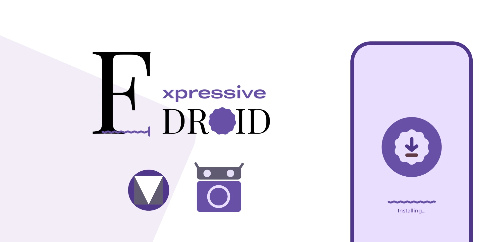

  

  
  
  
  

# E-Droid
E-Droid is a Material Expressive client for F-Droid. Download, search, filter, all using a beautiful Material UI.

Browse the free and open-source apps of F-Droid (and any other F-Droid compatible repo) in an app that actually feels like modern Android.

## Features
- 🎨 Material 3 Expressive design with dynamic colors
- 🔍 Search with recent searches
- 🗂️ Browse apps by category
- 📦 Add multiple F-Droid repositories and filter apps by repo
- ⬇️ Download and install apps directly
- 🔐 Signed repository index verification

## Screenshots
||||
|--|--|--|
|  |  |  |
|  |  ||

## Support
- 💬 Join the [Discord server](https://discord.gg/SNfcuuJeYF)
- ☕ [Buy me a coffee](https://buymeacoffee.com/evankoe)
- ⭐ Star the repo if you like it!

> Warning: I used AI to help me building this app
